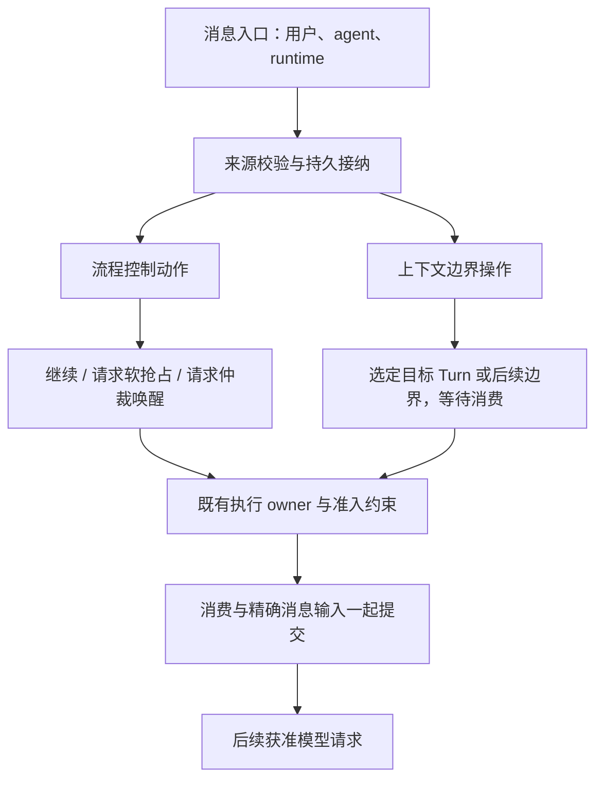

# 消息投递路径的流程控制与上下文边界分层

消息路径分层的询问回写实现与联合验证见 [收口记录](release-verification.md)；各类证据的覆盖边界保留在该记录及 joint-task-evidence.md。用户明确的分层对象是消息投递这一入口/方式。消息投递是上下文变更的一种方式；其他上下文变更由各自机制管理。

## 1. 一条消息路径，两个独立职责

**流程控制决定这条消息是否请求抢占、取消或唤醒；上下文边界操作决定这条消息何时、以什么身份进入哪次模型请求。**

消息入口先完成来源校验与持久接纳。随后把产品语义分解成这两个职责，由原 SessionActor/Timeline 所有者落实。消息正文不是执行控制指令，投递到 next-step 也不自动意味着取消当前请求。

这是职责图，不要求新增两个服务或新的通用命令总线。独立的 cancel 没有消息时，不经过消息接纳与消费路径；产品如需“取消并发送”，才显式组合两项操作。

## 2. 消息路径中的三个问题

| 问题 | 内容 | 已有权威 |
| --- | --- | --- |
| 接纳哪条消息 | 来源、稳定 identity、原 payload、真实用户 Hook/权限证据或 runtime 归属 | 现有 Input / Notification admission |
| 是否改变执行节奏 | 保持当前执行、软抢占当前 request、请求 idle 仲裁；终结 Turn 是另一个显式动作 | SessionActor、sampler、执行 owner |
| 在哪消费消息 | exact Turn 的后续安全点、后续 Turn、空闲期间保持 pending；消费与精确输入原子提交 | Input route / Notification source、Timeline、现有边界栅栏 |

接纳是共同前提，后两项是此次分层。wakeup 只请求仲裁，不授予执行资格或改变 FIFO 优先级。边界消费不修改已经发出的请求，也不迁移运行中的工具现场。

## 3. 只统一消息相关入口

| 入口 | 流程控制动作 | 上下文边界操作 |
| --- | --- | --- |
| 用户普通输入 / followup | 请求正常仲裁；既有配置允许时可提升为 steer | 先 durable FIFO；按已接纳身份消费或重路由 |
| 用户显式 steer | Grow 当前会软抢占 sampler request，结算后续同 Turn | 绑定 exact TurnId；安全点消费；接纳前失效拒绝，已接纳残留才按原规则回 FIFO |
| parent message, interrupt=false | 不抢占；保留现有 idle 仲裁策略 | durable Received 后按既有通知规则消费 |
| parent message, interrupt=true | Received 后请求原 request/可中断等待抢占 | 同一收据在安全点消费；不靠取消制造另一份消息 |
| agent reply | 不允许上行抢占；是否唤醒沿现有 owner 规则 | 依据真实原消息关系接纳 attributed reply |
| task/monitor/subagent 通知 | 由其原 source/owner 判定是否请求新工作 | 复用既有通知消费；工具结果已表达的证据不重复注入 |
| TaskStillRunning | 单独不 autostart | 保留给下一真实 Turn |
| ask 完成后的 inject（新增） | 不抢占、不主动唤醒 | 回答方持久接纳咨询事实，在下一获准边界消费 |

DSH `steer` 不取消当前推理，Grow 当前同名产品动作会软抢占 request。因此本次不按名字合并实现，而是明确 Grow steer 是两个职责的组合。ask inject 不能放进当前 `pending_interjections`，因为 sampling select 会把该 buffer 当作抢占信号。

统一心智模型不要求把 HumanIntent 与 runtime 通知合并成一种持久类型。它们共用边界规则，同时保留来源、Hook 和权限差异。

## 4. 对这条路径的对抗性约束

1. **信号不能早于消息接纳。** 接纳失败不得先停掉当前工作；ACK 不明通过原身份核对，不能重发成新消息。既有 interrupting parent 路径已经先收据后信号。
2. **软抢占与 Turn cancel 不同。** 用户 steer 的旧 request 先结算，后续仍属同一 Turn；cancel 结束精确 Turn，不能把它们合成一个无作用域的 interrupt。
3. **no-wake 不授予下一 Step。** 最终回复前的候选快照只固定此次决策能消费的 IDs；候选使仍获准的 Turn 续跑时，后到消息可加入新安全边界。最终关闭胜出后才等待后续 Turn。预算、取消、Behavior 或原 owner 的结束决定优先；不引入 min_turn 路由，也不往已结束 Turn 填消息。
4. **工具批次不能被上下文消息拆开。** inject 既不取消工具，也不在未闭合的结构化工具交换中途插入新消息。下一次安全消费使用既有批次与 Step 边界。
5. **Received、Consumed、provider 接收到请求、模型认可不同。** Consumed 后请求发出前崩溃，只恢复已经提交的 Surface，不重复消费，不声称模型已读取。
6. **恢复不能创造新的来源或 owner。** 新咨询成功证明绑定原回答 Session/Sideband。fork 继承历史不能重建他属待办；历史 Answered 不自动回填。只读 replay 不触发投递修复。
7. **权限不能从正文推导。** 咨询中的“批准”不会成为 PermissionEvidence；runtime 通知也不借用用户 admission 运行 Hook 或获得新任务授权。
8. **同步失败不能回滚真实回答。** 已提交 Answered 保留；缺失收据由原 writer 根据 canonical 事实协调。不可静默漏掉、无限重试或重跑 Sideband，也不另建 outbox/applied 账本。
9. **唤醒、优先级与队列保留独立。** “取消并发送”如未来成为产品命令，必须明确原 exact owner、消息接纳与取消各自结果、旧 FIFO 保留和顺序；两次调用不能宣称跨面原子事务。本轮只明确边界，不新增该命令。

持续收到 inject 可能延长活跃 Turn、增加 token，这是允许在关闭前追加 Step 的真实成本；沿用原预算和终结准入，不凭空添加配额/超时策略。

## 5. 与其他上下文变更的关系

模型/Agent 切换、Behavior/Goal/Plan Control、compaction、rewind、fork 的接纳、提交和生命周期仍由原机制负责。消息路径只观察它们已发布的执行资格、当前 owner 与合法边界，不调度其操作，不解释它们的变更 payload，也不把它们封装成通知。

例如：压缩改变 Surface 后，待消费消息仍通过原 Timeline 消费入口追加；消息投递不负责生成/发布摘要。Behavior 变更终结旧 Turn 后，消息按原 route 规则等待/拒绝/重路由；消息投递不负责实施 Behavior 转换。fork 是否继承文本由 fork 决定，消息路径只确保原 pending 收据不能在新 owner 上重复执行。

已调查的周边机制见 [核对记录](surrounding-mechanisms.md)，仅作为边界证据，不是本方案的重构清单。

## 6. 最小实现增量与验证

先完成 ask 成功→被动接纳→真实下一请求/恢复的闭环，回改它涉及的消息流程控制与上下文消费边界。其他消息入口用上述分解说明已有组合；不先改造全部入口或建设通用框架。

验证必须覆盖阻塞 stream/tool 非抢占、final-close 两侧、预算/取消优先、Consumed 后请求前崩溃、terminal→Received 故障、fork/旧记录不回填、权限来源、held FIFO 与 idle 不唤醒。生产实现与运行时验证仍未执行。
