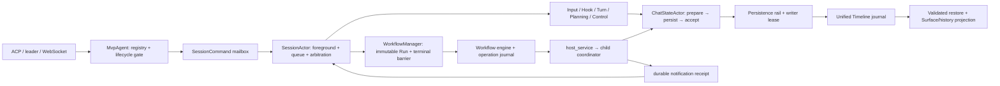

# Session orchestration / Timeline / Workflow 架构审视

审视基线为 `d6128138cacdc22553aba9dafba9bc6cc934e4d1` 加共享工作树；46 个本地 release tags 为 `v1.0.0..v2.6.0`，仓库非 shallow。`v2.6.0^{}` 为 `5475dff997f05cf6c67ab8ba24621ac8863c144a`，该 tag 到 HEAD 在本区跟踪路径没有差异。本文只记录审视，不实施修复、修改规范或登记 backlog；跨区合成和最终验证由父协调负责。

当前最需要修复的是输入恢复边界：有效挂起树带未消费 steer 时，通用恢复会请求一个被 Timeline 明确禁止的重路由，使冷恢复失败；编辑后的 FIFO 在恢复时丢失原位置，并混淆 admission prompt identity 与队列运行 identity。稳定输入重试还有运行态参与请求身份判断、重复状态投影与 canonical fold 不一致的问题。Workflow 的主要 owner 边界已经建立，但 journal 对模糊写入的恢复确认和冲突 completion 校验仍有缺口。

## 1. 输入、范围与证据边界

已读根 `AGENTS.md`、`openspec/README.md`、本 change 的 `proposal.md/design.md/tasks.md`，以及 `session-timeline`、`input-admission`、`behavior-goal`、`task-planning`、`workflow-execution` 的主规范。已加载 `software-engineering` 入口及 `rust`、`directory-structure`、`handoffs` 参考。未发现适用的更深 `AGENTS.md`。主规范是契约来源；下面的源码和 Git 历史只用于核对实现。

责任区为 `shell/src/agent`、`shell/src/session`、`chat-state`、`prompt-queue`、`workflow`，以及 shell 内非配置扩展的 session 调用方。路径前缀均为 `crates/codegen/`。覆盖分两层：对所有模块族建立入口与 owner 对应，对可能破坏持久化、恢复、取消和通知不变量的执行链深入读实现及相关测试。没有把文件计数、文件大小或关键词命中视为执行链审视。

- 深审：ACP new/load/prompt/cancel 到 actor/Timeline；输入接纳、排队、编辑、steer、冷恢复；前台仲裁与 Turn 结算；SessionThread 和 persistence rail 的退休；运行时挂起/恢复；通知 receipt 与消费；local planning 更新/交付绑定；Workflow launch/resume/terminal/journal/child 去重。
- 接口核对：模型路由安装、采样 admission/usage/terminal、工具 preflight 与授权、Hook/Sideband、图片/compaction、rewind/fork、coordination、只读查询。模型控制已有专题 review，sampling 与工具授权交其他责任区；本文不重复其完整实现调查。
- 库级轻量实验已执行：直接包含当前 `workflow/src/journal.rs`，用已存在的 Rust 依赖产物编译到 `/tmp`，验证冲突 completion 和 append 后同步失败。没有运行 Cargo、启动 Grow、访问真实 provider、改真实 session 历史。父协调要求暂缓重型 Cargo，本文保留待运行命令和断言。
- Atlas 调用返回了旧 `session/acp_session.rs` 等不匹配当前源码的导航结果；不采信其行号或架构结论。历史结论来自 Git 对象、实际 diff 与对应版本代码。

证据文件在交付前仍未被工作树修改，其 Git blob 为：

| 文件 | blob |
| --- | --- |
| `shell/src/session/actor/input_admission.rs` | `2ef17be59b13c46c143520ac3282b01713f58ec5` |
| `shell/src/session/actor/prompt_queue.rs` | `05a6a5db6dedc93b0a2c3390f87eead664f044b1` |
| `chat-state/src/timeline.rs` | `a36d37d87e9de978e66e7db1d42ef170c25ef251` |
| `workflow/src/journal.rs` | `77e15f0dbe80829e343ac818853621ff226c31c5` |
| `shell/src/session/workflow/manager.rs` | `aadd0eeeba5725120b68290f499e14b1c0269700` |

行号指上述审视时的文件；活跃 coder 修改可能令其他文件行号移动，应以符号和 blob/commit 定位。

## 2. 模块与 owner 覆盖

`rg --files` 的模块清单在审视中覆盖 `agent` 69、`session` 246、`chat-state/src` 22、`prompt-queue/src` 3、`workflow/src` 7 个文件；这些数字包含测试，工作树新增文件仍会变化。下表列出全部责任族，不表示每个测试或辅助实现都逐行深审。

| 模块族 | 实际入口 / owner | 权威、恢复、取消边界与本次深度 |
| --- | --- | --- |
| `agent/app/init/server/mod`、handlers、`mvp_agent/acp_agent/agent_ops/session_lifecycle` | stdio/leader 或远程 WebSocket → `MvpAgent` → `SessionCommand` | manager 持有 session registry、逐 session lifecycle gate、dispatch lock、writer replacement；SessionActor 独占执行。读入口、new/load/prompt/cancel/close 和失败初始化退休链。远程连接允许更换通知目标，未做跨网络慢连接压力实验。 |
| `agent/activity/roster/session_metrics/session_config/restore_code` | 活动和只读会话查询 | 查询不拥有执行权；区分 resident runtime snapshot、durable history、unavailable。核对 handler 及 runtime observation 的关联；列表排序、UI 和配置目录归对应分区。 |
| `agent/models/provider_catalog`、handlers/model_switch、`mvp_agent/session_model` | 模型目录 / session desired-state 控制 | 仅核对安装、共享 route snapshot、Workflow 新 Run 默认路由接口。`set_session_model` 活跃修改，待父在 coder 完成后终审。 |
| `agent/subagent/{handle_request,mod,finalization,observation,resolution}` 与 `mvp_agent/subagent_coordinator*` | Task/Workflow child 请求 → coordinator → child runtime | parent Spawned、child Seed/Result、parent Ended exact result reference；收尾失败保留责任，不用取消 token 代替 terminal。深入 result/receipt/recovery writer 链；Task resume 活跃代码不作最终验收。 |
| `session/commands/handle`、`actor/{mod,types,spawn,run_loop,teardown,tasks_cancel}` | command mailbox / 每会话 OS thread + current-thread Runtime/LocalSet | `AdmissionState` 是前台、队列、termination/suspend 的 owner；`SessionHandle` 暴露通信和只读快照。SessionThread 退休必须确认 actor 和 persistence task 均完成。深审。 |
| `actor/{input_admission,prompt_queue,interjection,idle_arbitration}`、`input_inbox/prompt_queue` | ACP QueuePrompt / queue control / steer → durable Input → idle arbiter | 用户 payload 先发布再 Submitted；Hook/AdmissionResolved 后才排队；已消费输入不重做。当前 F1–F3 位于该族。深审。 |
| `actor/turn/{admission,sampling,settlement}`、`events/result/acp_conversion` | arbitrate → AgentTask → Turn/Step → model/tool → terminal | foreground 有唯一任务；TurnStarted 在执行前确认；终态 durable 后才发布完成；失败不能继续成功 projection。采样内部交其他区，核对 fatal boundary 和结算调用。 |
| `actor/{runtime_source,suspension}`、`mvp_agent/runtime_handoff`、`chat-state/session_runtime` | tree suspend/prepare/commit/release/retire | 逻辑 Turn、child、Workflow identity 独立于物理 runtime；tree 校验和 root commit 后才 release。读 checkpoint 与 open-turn 保留、writer drain、restore gates。F1 是恢复重建层未遵循此 owner。 |
| `chat-state/{timeline,actor/*,commands,handle,persistence,types,events}` | ChatStateHandle → ChatStateActor → Timeline prepare/persist/accept | Timeline 为唯一 canonical authority；Surface、prompt index、planning 是 fold。actor 单 pending exact event、bounded retry、poison writer。深入生命周期、Input、notification 与恢复；request builder/compaction 仅核对边界。 |
| `session/{persistence,storage*,storage_admission}`、`history/*`、`response_projection/replay_events` | ChannelTimelinePersistence → persistence rail → contained JSONL journal | writer lease 和 exact ACK；统一物理日志同时持有 domain 与有限 presentation facts，response 正文来自 canonical admission。深入 writer recovery、prefix、history cursor/anchors；底层 filesystem containment 完整安全审查归数据区。 |
| `actor/notification_drain`、`notification_inbox`、`actor/completion_delivery`、`signals/pending_interaction` | background task/child/agent message → immutable artifact → receipt → model context | exact source/version/hash 去重；Received 先确认，消费和模型可见 message 同一 durable transition；未知 ACK 保留 artifact。深入 publication/GC 与 receipt，不把 UI 投递当消费。 |
| `session/{behavior,control,goal_tracker}`、`actor/{session_mode,goal,goal_support}` | Behavior/Goal desired-state command → pure transition → Control | Behavior 与 Goal 控制状态是 Timeline Control；runtime lease/clock 不持久化。主规范限制自动 Goal admission，手动用户输入与 Goal 续跑区分；接口核对结合 turn/arbiter 深审。 |
| `actor/planning`、shared planning tool/resource | todo_write / child result / parent update → SessionActor → Planning event | plan update 在 gate 下持久确认后 hydrate；review 绑定 exact child result reference；replan Pending/Dispatching/Received/Consumed/Handled；wait 只占指定 scope。深入 owner 更新、通知重试、依赖唤醒和 completion blockers。 |
| `session/workflow/{manager,store,tracker,host_service,notify}`、`actor/workflow_run` | Workflow host command / tool → manager → Rhai engine / child backend | 独立 Run identity、immutable script/args/route；active.done 是上一 execution 的 terminal barrier；Timeline lifecycle 是恢复发现权威，sidecar 是可修复进度。深审。 |
| `session/workflow/{workspace,registry,schema_contract,mod}`、`workflow/{lib,meta,validate,run,host}` | definition discovery/validation/publish → frozen Run | Definition 和 Run 分离；dry-run 是 stub host，不能证明线上 agent 结果。读类型/验证接口及 manager 调用；workspace 目录的全面配置/安全审查不在此重复。 |
| `workflow/{engine,journal}` | bounded Rhai evaluation → request hash → operation intent → host result | 无能力的 engine 只使用注入 host/storage；journal dense seq、request hash、pending operation ID。host 在重放 pending child 时核对 canonical operation，不新建逻辑 child。深审并执行 F4/F5 实验。 |
| `actor/{prompt_build,reminders,updates,stop_gate,auth_retry,slash_exec}`、`session/{slash_commands,user_message,helpers/*}` | 前台输入准备 / boundary / 输出适配 | 核对它们进入同一 Turn/Hook/Control/Timeline owner，不另设前台调度器。具体 prompt/skill、Stop hook、auth 策略交对应区；只对本次恢复/结算链深入。 |
| `actor/{compaction,context_recall,sideband,memory_dream,recap,summary,laziness*}`、`memory*`、images、context、diagnostics | 当前 Turn 或 session activity → 可取消辅助任务 | admission/teardown/suspension 必须关闭或等待活动；Sideband、compaction 消费/费用通过既有 ports。仅核对 session owner 接口，不重复采样、记忆、图片专题。 |
| `actor/{mcp,mcp_snapshot,hook_dispatch,hooks,hooks_plugins,skill_loading,tool/*}`、`session/{mcp*,agent_rebuild,capability*}` | tool/catalog/profile runtime boundary | 任务执行、Hook、权限与 sampling 已有独立责任区；核对 session safe boundary、cancel、错误返回和工具批次完整性。活跃授权修改列最终复核，不扩张调查。 |
| `actor/rewind`、`session/fork`、storage descendant recovery、file state | 显式 rewind/fork → validated prefix / transaction | rewind 禁止未解决 Goal，checkpoint branch owner 阻止提前修改；fork 通过 storage 创建新 lineage。读 public入口、恢复调用和 owner 限制，文件回退具体事务由数据区合成。 |
| `session/unified_list/*`、trajectory、testkit、memory hooks、support | 只读 projector / 合成测试入口 | 不应获得运行或授权权威；依据统一 Timeline 重建。枚举/接口核对，未逐行复核 HTML、全部 benchmark 或测试 fixture。 |

shell 外围调用方也按入口核对：`leader/server.rs` 的 driver/child route/exit scope 是传输与路由，生命周期仍交 MvpAgent；`tools/notification_bridge.rs` 对 task/monitor/scheduler completion 携带 session identity、持久化 ACK 和 SessionCommand；`coordination/runtime.rs` 将有身份的 inquiry 交 dispatcher/SessionActor，而非直接插用户消息；`inspect/mod.rs`、`trace_classifier/mod.rs` 是历史读取；`terminal/mod.rs` 的 session 引用主要是共享错误映射；`mcp_doctor.rs`、`test_support/lsp_runtime.rs` 是辅助入口。配置 watcher 和 extensions 的具体策略交其他区；不能据此宣称本区完成其配置/授权安全审查。

## 3. 关键执行链和不变量



1. **new/load/reconnect**：`acp_agent.rs::new_session/load_session` → manager 生命周期锁/既有 writer drain → contained storage/validated Timeline → `spawn_session_on_thread` → ChatStateActor bootstrap recovery ACK → SessionActor inbox/control/workflow 恢复 → runtime tree prepare/commit/release → replay/可执行 handle。Resident reconnect 保持原 actor，以 mute guard 和 writer barrier 固定 history cut；不应把展示完成当作 writer 退休。
2. **普通 prompt/FIFO**：稳定 `promptId` → QueuePrompt → `queue_input` → payload artifact → Submitted → UserPromptSubmit Hook → AdmissionResolved → `pending_inputs` → idle arbiter → foreground AgentTask → durable TurnStarted/Consumed → sampling/tool → durable TurnEnded → waiter 和展示。held head 不允许后项、notification 或 Goal 越过；保存编辑必须先持久替换后释放 hold。
3. **steer/followup**：捕获 exact foreground Turn → payload/Hook → recheck target under step gate → AdmissionResolved::Steer → pending interjections → 原 Turn 的安全边界消费。正常终态才把未消费残留重路由为 FIFO；挂起保留原 Turn，不能套正常目标死亡规则。
4. **通知/交付**：artifact → exact Received receipt → 合法队列/中断策略 → 同一消费 transition 增加模型上下文 → UI 投影。已收到重试应先查 receipt 再看运行 liveness；模糊写入只报未确认，不删除可能已被 Timeline 引用的 artifact。
5. **child/Task**：parent Spawned → child Seed/控制/首轮 admission → child执行 → child terminal/usage结算 → output artifact + child Result → exact parent Ended result_ref → planning/completion receipt → owner retirement。`finalization.rs::advance` 等待旧 child actor/persistence 退休才获取 recovery writer；阻塞 I/O 超时后 worker 仍持有 lease，不能由另一个 actor 接管。
6. **挂起**：关 admission、停止辅助活动、settle interactions/hooks、保留 Turn cursor → checkpoint + child tree/commands barrier → root committed suspended → 物理 actor/persistence 退休。restore 校验原 route/workspace/child identity/Workflow source → Prepare/Resumed root barrier → ExecutionReleased → 恢复原 Turn/Run。返回 Suspended 不能伪装 Completed；close/cancel 才结束逻辑工作。
7. **Workflow**：validated definition → store immutable script/args/route → Timeline Spawned seed → manifest ACK → bounded executor → begin_operation durable pending ID → canonical child dispatch/reuse → complete_operation → typed outcome → manifest/Timeline Ended → done barrier → model-visible handoff receipt。resume 先等旧 `active.done`，再使用原 immutable sources；Definition 编辑不会改原 Run。
8. **planning/Goal**：tool只发 typed command，SessionActor 用当前 prompt/step gate 更新 LocalPlan，持久化后才更新 projection；review 验证 child result canonical reference。Goal 的自动 continuation 经过同一 arbiter 和 budget，不能跨过用户 FIFO/hold，手动用户 Turn 不隐式重启 paused Goal。

分层判断：`ChatStateActor + Timeline`、纯 `BehaviorCoordinator/GoalTracker`、纯 `prompt-queue::combine` 和注入 `JournalStorage` 的独立 workflow crate 均有实际 owner/可测试边界，未见必须再抽一层公共调度实体的理由。主要重复规则位于 shell 自行扫描 Timeline 重建输入状态（F3），以及 inbox rebuild 自行决定历史路由/位置（F1/F2）；这些派生层在恢复时越过 canonical owner 的事实。应收敛事实查询和重建契约，不因文件大而再建通用框架。`InputPayload.prompt_id`、`QueueEntryMeta.id`、`TurnId`、`input_id` 各有用途，但当前恢复把不同身份合并使用，必须明确转换边界。

## 4. 当前发现（按影响排序）

### F1 — P1：挂起 Turn 带未消费 steer 时，冷恢复请求非法 reroute，整个 session 初始化失败

**触发**：普通 Turn 已接受一个绑定它的 steer/followup，尚未消费；随后成功挂起并退出物理 runtime，再通过 load/resume 重建。steer 是未 reserved 的 pending input，因此会出现在 `get_pending_allowed_inputs`。

**位置与链**：

- `chat-state/src/timeline.rs:3084`，`recover_interrupted` 在 `runtime.preserves_open_turn()` 时直接返回，保留原 active Turn；这是挂起的正确 owner 规则。
- `shell/src/session/actor/spawn.rs:2839` 调用 checkpoint-aware recovery，`:2871` 随后仍无条件调用 `restore_pending_human_inputs`，不因 `runtime_recovery_gated` 跳过。
- `actor/input_admission.rs:600`，只要 pending route 是 Steer，就请求 `reroute_input(...Fifo)`，没有核对目标是否为保留 Turn。
- `chat-state/src/timeline.rs:6871`，`valid_input_reroute` 只允许 `seen_turns.contains(target) && active_turn != target` 的 Steer→Fifo；当前有效 checkpoint 仍保留该 active target，故返回 InvalidInput。错误向上变为 `failed to restore pending human input`，restore 尚未到 `suspension.rs::prepare_runtime_restore` 重新绑定前台便失败。

**后果/不变量**：有效树无法冷恢复，原输入和工作还在磁盘但不能续跑。不是 steer 被静默执行两次，而是正确的 Timeline 校验拦住了错误的恢复操作。违反 `input-admission` 的 `Suspension preserves admitted input ownership`、特别是 “A targeted input waits on the suspended turn”。

**缺失边界/owner**：输入重建必须向 runtime/Timeline owner 查询原 target 是否保留；仅真正被 recovery/terminal 关闭的 target 才允许 reroute。owner 是 shell input rebuild 与 session runtime restore，Timeline validator 不应放宽以掩盖此问题。

**历史**：无条件 reroute 已存在于 `v2.1.0` 的 `input_admission.rs:246`；当时进程恢复先关闭 interrupted Turn，前提成立。`2e69e5db8` 在 `v2.4.0` 引入保留 open Turn 的挂起语义，至 `v2.6.0`/HEAD 未调整该重建条件；这是旧规则与新 owner 合成后的缺陷，不应归咎于早期版本不支持挂起。

**可证伪通过标准**：生产 spawn/load fixture 创建 Turn T + 一个 allowed、未 consumed 的 Steer(T)，完成 suspended checkpoint 后销毁 actor/persistence，再冷 load。应成功到 Prepare/Resumed/ExecutionReleased；Input route 始终绑定 T，原 Hook 不重跑，恢复 T 在安全边界恰好消费一次。对照组为无 checkpoint 的 process interruption：应先 durable 关闭 T，再一次 reroute FIFO。静态完整链已确认，尚未运行该 Rust/进程级实验。

### F2 — P2：编辑后的 FIFO 恢复顺序变化，运行身份与队列行身份分叉

**触发**：队列有 A、B，A 尚未执行；保存 A 的编辑，持久化新 Input A′ supersedes A，然后崩溃或挂起冷恢复。禁用 combine 可单独观察顺序；即使 combine 开启也会改变拼接顺序。

**位置与链**：

- `actor/prompt_queue.rs:827`，`replace_queued_prompt_with_admitted_input` 在 live 队列原槽位替换内容。`:903` 将 admission payload 的 `prompt_id` 设为 `original:edit:N`；`:916` 中 queue metadata 仍保持原行 ID，`:946` 只换 input_ids、blocks、queue_meta，live `InputItem.prompt_id` 仍原 ID。
- `chat-state/src/timeline.rs:2910`，`pending_allowed_inputs` 按物理 Submitted 顺序返回；`:5650` 附近 AdmissionResolved::supersedes 把 A 标记 RouteSuperseded，却不记录“新 input 继承 A 的队列位置”。故 durable 顺序为 Submitted(A), Submitted(B), Submitted(A′)，pending 恢复成为 B,A′。
- `actor/input_admission.rs:618` 用 `push_back` 顺序重建，并在 `:620` 把 payload 的 `original:edit:N` 写为 runtime `InputItem.prompt_id`；`:606` 直接恢复 queue metadata，其 `id` 仍 `original`。
- `actor/prompt_queue.rs::is_running_prompt/build_queue_wire/handle_clear_queue` 及 `actor/mod.rs::running_prompt_id` 使用 runtime prompt identity 与行 ID 的相等关系判断当前项，`runtime_observation` 也以 runtime prompt ID 建队列/终态索引。恢复后的两个身份不再相等。`build_queue_wire:478` 的 running 排除条件即可看出差异；不能把这些投影视为原请求身份已正确恢复。

**后果/不变量**：B 可越过编辑后的 A，用户明确依赖先后顺序的工作按另一顺序执行；恢复后按原 prompt ID 查询/控制不能稳定对应运行身份。部分 queue 操作会把同一 runtime item 当 queued 而非 running，再由后续 Input lifecycle 校验报错。未实测所有 UI 操作，因此不声称能越过 Timeline 消费锁取消别人的 Turn。违反 `Completion of queued editing returns to ordinary FIFO arbitration` 和挂起输入原顺序/身份保留契约。

**缺失边界/owner**：durable replacement 没有为 queue owner保留原位置和运行/display prompt identity；cold reconstruction 根据 admission payload 的字段猜队列状态。owner 为 `InputEvent` 的替换语义与 shell queue restore。已有稳定 input identity 与 queue row identity 足够，应先明确重建映射，不能只把 `:edit:` 名字换回去而忽略位置。

**历史**：durable replacement 接纳在 `7a046d460` / `v2.1.0` 已存在，Submitted 次序重建也已存在，因此顺序问题至少从 `v2.1.0` 可见；`0a0dd07cd` / `v2.4.0` 为稳定重试引入 `input_prompt_id = format!(...:edit:...)`，增加了恢复 identity 分叉。两个因素在当前均未修复。

**可证伪通过标准**：对 A,B,C 编辑 A 两次、B 一次，分别在 replacement ACK 后的每个边界冷恢复，始终保留 A,B,C 顺序、唯一行 ID、当前 revision/正文；runtime prompt identity、状态查询和控制仍对应原行，旧 input 永不再消费。保存失败仍保持原内容/hold。补测 `handle_reorder_queue:960`：该 API 目前只改内存；显式 reorder 的恢复语义应一起核实，但本文不把未单独定义的 reorder 持久性另列高优先级缺陷。

### F3 — P2：稳定提交重试受当前 foreground 影响，且重复状态扫描与 canonical fold 不一致

**触发与证据**：

1. idle 时提交 P，接纳后 ACK 丢失；P 开始运行时用同一 ACP 请求重试。`queue_input:200` 在每次请求中计算 `entered_during_regular_turn`；`:255` 据此把同一请求从 Prompt 改判 Followup。`input_admission.rs::find_existing_prompt_input:394` 把 intent 不同直接视为身份冲突。相反，运行中提交的 Followup 在原 Turn 结束后重试也会变 Prompt。不可变 `requested_route` 在两次请求中都是 Fifo，变化来自服务端运行态。
2. 即使 intent 未变，`admit_human_input:74` 对 Allowed 返回 replayed；`queue_input:273` 直接调用 `respond_removed_prompt`，不返回原接纳/消费状态；对 Consumed/Handled/Dismissed 则在 `input_admission.rs:84` 返回普通错误字符串。已读 ACP `prompt` caller，没有把这些分支转成具有原 Input identity 的权威重试结果。
3. `existing_input_state:758` 再扫描事件，只认目标自身 AdmissionResolved 和显式 Dismissed。canonical fold 中另一个 replacement 的 `AdmissionResolved.supersedes=[old]` 已把 old 标为 RouteSuperseded，但该 helper 不检查 supersedes，仍将 old 报 Allowed。对旧输入的重复请求会取得与 Timeline 当前状态不同的判断；由于 replayed 分支不重排队，本次没有证据表明会重复执行旧内容。

**后果/不变量**：客户端无法把 ACK 丢失后的同一请求与“新请求冲突/被移除”可靠地区分；相同输入的重试结果依赖另一个 foreground 是否恰好还在。违反 `User submission retries retain one durable input identity` 的同请求返回原接纳与消费状态。问题在执行状态查询/投影，不是 canonical input hash 本身碰撞。

**缺失边界/owner**：请求原始 intent/route 必须在 stable identity 首次接纳时固定；同请求重试先查询 canonical lifecycle。shell 不应维护忽略 supersedes 的第二套 Input 状态 fold。owner 是 admission API、queue caller 和 ChatState 的只读事实接口。

**历史**：`d30f10f35` / `v2.2.0` 增加 foreground-derived Followup 分类；`0a0dd07cd` / `v2.4.0` 加稳定 input identity、payload conflict 和 existing-state 分支，合成当前问题。之前输入用随机 UUID；不能把其无稳定去重称为此实现已经正确。当前 `requested_route` 对不同显式路由的冲突校验是正向边界，应保留。

**可证伪通过标准**：同 promptId/相同原请求在 idle→running、running→idle、consumed、Handled、superseded、dismissed 和新 writer 恢复后重试，返回同一 input identity 及 canonical 当前状态，不新增 Submitted/Hook/队列项；改正文、图片、原路由或显式请求 intent 则在 Hook 前冲突。现有纯 payload comparison/普通恢复测试不足以覆盖这组状态转换。

### F4 — P2：Workflow journal 模糊 append 后，load 把可读完整行直接当已确认结果，未重做持久屏障

**触发**：`SessionJournalStorage::append` 的 `write_all` 已写入完整 completion 行，但随后 `file.sync_data()` 或 run directory sync 失败。engine 报 journal error、内存仍为 Pending；同进程/新 runtime 从缓存可读的文件恢复。

**位置/owner 链**：`manager.rs:50` 的实际 storage 依次 write_all → sync_data → directory sync；`journal.rs::append_physical_entry:388` 只在 storage.append 返回成功后更新 memory/bytes；`journal.rs::load_from_storage:130` 仅读取、parse/fold 完整行，只有 torn tail 才 truncate；`manager.rs::launch:674` 用该 loader 后执行恢复，`engine.rs` 对 `OperationReplay::Completed` 直接复用结果而不重新核对 child/该行 barrier。

**已执行实验**：直接使用当前 journal.rs，注入存储在完整 append 后返回 I/O error。`complete_operation` 返回 Err，live replay 是 Pending；`Journal::load_storage` 得到 Completed，recovery storage append 次数为 0。该 storage trait也没有确认既有前缀持久化的操作。实验严格证明 journal 层把“完整可读”提升为 completed；没有模拟真实文件系统掉电，也没有证明 canonical child 被重复创建。

**后果/不变量**：Run 可从先前被调用方判为未确认的结果继续做决策，且直接结束时不会有下一个 journal append 替它完成屏障。后续掉电可能保留已确认的 Run terminal，却丢失用于重放决策的 journal prefix。canonical child 的 pending operation ID/结果核对降低重复 child 的风险，不能替代 journal 自身恢复确认。owner 是 workflow `JournalStorage` 与 shell Run 恢复事务，不应仅由 tracker 的失败/可恢复状态推导“数据已 durable”。

**历史**：pending operation 与 injected JournalStorage 机制在 `6c35a4d50` / `v2.0.0` 已存在；`02c3e8098` 抽出 current fold/projector，`v2.1.0..v2.6.0` 的 workflow tree 相同，至 HEAD 仍有该行为。没有发现本区后续修复。

**可证伪通过标准**：实际 shell storage 在“完整写入后 file sync失败”“file sync成功后dir sync失败”注入；原执行失败，恢复在继续使用 Completed 或提交 terminal 前必须重新确认所读 prefix 的文件/目录屏障，或返回保持原 operation 的明确恢复受阻。该屏障失败不能被 `read_bounded` 成功覆盖。新的正常 append可同步旧前缀，但不能作为所有脚本必然发生的前提。

### F5 — P3：journal 对已完成 operation 接受冲突 completion，重放采用最后值

**触发**：磁盘/导入/projector收到三条相同 seq/kind/request-hash 的行：pending(A) → completed(A,result1) → completed(B,result2)。这里第三行是无效证据；本次未发现正常 engine 能在成功完成后自然产出该冲突行，因此优先级低于用户正常路径问题，不把它称为可触发的双派发漏洞。

**位置**：`journal.rs::fold_physical_entry:457` 只检查该 seq 曾有 operation ID、incoming result 不是 pending、kind/hash相同；第一次完成后保留 operation_ids，未要求现有 entry 仍 pending，也未要求 exact相同 completion。`:464` 无条件覆盖。live `complete_operation` 则要求当前仍 pending，读写校验不一致。

**已执行实验**：`project_physical_entry` 对第三条返回 `Ok(())`，`replay_operation` 返回 child-B 的新结果。`load_from_storage` 复用同一 fold，故完整文件也会得到相同结果。现有 `projector_rejects_another_physical_row_for_completed_seq` 测的是没有 operation ID 的普通 log，未覆盖 pending→completed 后的冲突。

**后果/owner/不变量**：无效 journal不会 fail closed，同一逻辑操作的不可变结果被最后一行改写；恢复与 Trajectory projector 可展示不同历史结论。owner 为 workflow journal physical fold。`Deterministic journal replay` 虽明确规定 kind/hash，仍应把完成结果的不可变性作为同一 logical operation 的完整性边界。

**历史与验收**：至少 `v2.0.0` 的相同条件已存在，`v2.1.0..v2.6.0` 及 HEAD 没有修复。pending→completed 一次可通过；同一 completed 的 exact重放若选择容忍必须不改变原值；任何不同 completion必须拒绝，live/loader/projector三条路径一致。需补 actual engine producer/I/O重试可达性测试后才升级影响判断。

## 5. 已有正向边界与历史已修复项

以下不再列当前缺陷，也不把“现有测试名称存在”视为本轮通过：

- **长插话尾部丢失**：v1.0.0旧`common/xai-interjection-core/src/format.rs::format_interjection`按25,000字节截断，迁入`tools/src/interjection`后规则曾继续存在；`219220f4e`（v2.6.0）移除截断，当前共享formatter保留全文及尾部指导，已有`preserves_long_utf8_text_and_trailing_guidance`。已读旧core全部buffer/events/format与当前formatter；这是历史已修复，不列当前缺陷。
- **Timeline persist-before-accept**：当前 actor 保留 exact pending event、有限重试/明确 deadline、永久失败 poison；新 writer 需在旧 actor+persistence rail drain 后恢复 exact前缀。`v2.0.0` 的 actor 已采用持久化后 accept，但 transient循环仍无总期限且磁盘满等不在永久分类；`ea0a35942`（首发 v2.0.1）等后续边界硬化进入当前实现。当前确认不能仅凭 helper API存在推断 caller 已成功，已沿 mailbox/result读到上层失败路径。
- **Session reaper 队头阻塞**：`b9df879e0`（v2.1.5）前，global reaper 按到达顺序 `handle.join()`，一个活前驱阻塞后面已完成session；修复改为pending集合逐项检查is_finished，当前仍有 `reaper_completed_session_is_not_blocked_by_live_predecessor`。这是历史已修复的生命周期问题。
- **普通输入附件恢复**：`09c68b808`（v2.1.3）把昂贵序列化/Hook prompt 构造移到blocking任务，并将缺附件 pending input durable Invalidated、保留Submitted审计根，让其他输入继续。当前仍有 `large_input_recovery_reuses_admission_and_snapshot`、`missing_input_attachment_is_invalidated_without_blocking_other_inputs`；不应为绕过F1而删除pending恢复场景。
- **Workflow authority**：`8352678fb`（首发v2.0.0）将Spawned/Resumed/Ended接入Timeline；`02f435ebc`（v2.1.0）给Spawned冻结manifest/script/args哈希并在预校验失败时回滚。当前只在 `TimelineWriteError::Invalid`（明确preappend拒绝）后移除unspawned source，ACK未知则保留source和run identity；旧diff中不区分未知错误的回滚已不再是当前代码。现有 `acknowledged_spawn_with_lost_caller_reply_keeps_recovery_source` 是直接覆盖点。
- **Workflow terminal barrier**：当前 `launch:599` 对resume目标先等owned active.done，再reap；`pause/cancel/suspend_all_and_drain` 等待相应terminal ACK，manifest失败/closed ACK都不授权新epoch。现有 `resume_waits_for_terminal_manifest_and_timeline_acknowledgment`、`resume_propagates_terminal_ack_failure_without_advancing_epoch`、`shutdown_drain_preserves_terminal_watcher_error`。F4关注另一条journal恢复屏障，不否定此Run lifecycle边界。
- **通知与planning交付**：immutable Received/source/version/payload精确去重，未知ACK保留payload；消费与消息发布合并；planning结果验证子会话canonical reference而非字符串seq。`schedule_planning_delivery`采用可取消bounded backoff重试；missing/failed dependency唤醒决策，不能当成功。`review_binding`对模型给出完整字段，已有completion blockers约束未验收交付。
- **child结果与物理退休**：`finalization.rs::advance:155` 等待旧child thread+persistence结束；blocking I/O超时后保留ownership。result_ref连接child Result与parent Ended，而UI Finished/progress不复制完整答案或代替canonical结果。Task resume的新实现仍需最终复核，不能把基线静态判断当其验收。

## 6. 46 个 release tags 覆盖账

每个tag均执行Git manifest/tree盘点并检查相邻diff及其提交；不是只选若干代表tag。下表的Git tree/指纹均显示前12位，完整对象可用tag:path重算。A 是该tag下 shell `src/agent/** + src/session/**` 的 `(相对路径,blob)`排序清单SHA-256；S/C/P/W 是完整 shell/chat-state/prompt-queue/workflow crate tree（S包含本区外shell文件，仅作完整目录对象证据）；M 是这些crate `Cargo.toml`的路径/blob排序清单SHA-256。Δ 是相对上一行的本区路径及下述caller的 `变更文件数/+行/-行`，使用 `git diff -M --numstat`；包括测试，不能把行数直接解释为架构影响。

Δ路径集合：shell的 `src/agent`、`src/session`、Cargo.toml，以及 `leader/server.rs`、`tools/notification_bridge.rs`、`coordination/runtime.rs`、`inspect/mod.rs`、`terminal/mod.rs`、`trace_classifier/mod.rs`、`test_support/lsp_runtime.rs`、`mcp_doctor.rs`；另含完整chat-state/prompt-queue/workflow。v1.0.0同时使用旧路径及下述三个已移除crate，迁移相邻diff取新旧路径并集。

| tag | A | S | C | P | W | M | Δ |
| --- | --- | --- | --- | --- | --- | --- | --- |
| v1.0.0 | ff05fa59ca13 | 1be70653c920 | bc68a957344b | 7dfa82982b3d | 1685143f7ad9 | 7e3d34739caf | base |
| v1.1.0 | 604a9329f09a | 71bcdb015a37 | cb1b32b296e5 | ab36c3354c7f | 739f385e6d5c | 81f120c63378 | 306/9964/14505 |
| v1.1.1 | 604a9329f09a | 4d69a9892a51 | cb1b32b296e5 | ab36c3354c7f | 739f385e6d5c | 81f120c63378 | 0/0/0 |
| v1.1.2 | 235018ad188b | 06c48664f9a9 | cb1b32b296e5 | ab36c3354c7f | 739f385e6d5c | 81f120c63378 | 37/1959/719 |
| v1.1.3 | b8f6aedeaf49 | f897ea18182d | cb1b32b296e5 | ab36c3354c7f | 739f385e6d5c | 81f120c63378 | 12/33/122 |
| v1.1.4 | 9917179a217f | 3fe34b160f5c | 4cb3eb545d8b | ab36c3354c7f | 739f385e6d5c | f3d4a0e67e88 | 50/5065/726 |
| v1.1.5 | 43d9ba02615e | 499a8192468c | 4cb3eb545d8b | ebe002db80da | 739f385e6d5c | d57a12ee6be5 | 105/9800/44439 |
| v1.1.6 | 33bda8b62df2 | 94e78417f5e2 | 4cb3eb545d8b | ebe002db80da | 739f385e6d5c | d57a12ee6be5 | 38/2451/760 |
| v1.1.7 | 1cdd95fc127e | ee32493b66e8 | 4cb3eb545d8b | ebe002db80da | 739f385e6d5c | fdf0e8648c90 | 24/3573/480 |
| v1.1.8 | 35c17d89aece | 6f71f2c8eba9 | 41c36daedd79 | ebe002db80da | 739f385e6d5c | 69b18493e649 | 61/6285/732 |
| v1.1.9 | 2f63705d80c8 | afbb04f5820c | 41c36daedd79 | ebe002db80da | 739f385e6d5c | 69b18493e649 | 2/59/12 |
| v1.1.10 | cc015c905cd4 | 234c0afb6940 | 41c36daedd79 | ebe002db80da | 739f385e6d5c | 69b18493e649 | 13/2133/114 |
| v1.1.11 | b119f250e172 | bd0edff020e6 | 41c36daedd79 | ebe002db80da | 739f385e6d5c | 69b18493e649 | 21/2082/189 |
| v2.0.0 | 07333197f9de | fc427caa9bcf | 8fac58d228c6 | ebe002db80da | afe8907d9b2f | ae11aef85dbf | 267/68071/63104 |
| v2.0.1 | 07971f6a0717 | e4fd0a316c72 | 894f6633b589 | ebe002db80da | afe8907d9b2f | ae11aef85dbf | 114/15787/5034 |
| v2.0.2 | 68dfafe8e198 | d24d82b06f46 | 894f6633b589 | ebe002db80da | afe8907d9b2f | ae11aef85dbf | 58/10315/1721 |
| v2.0.3 | 25b9652de4a2 | 131ff9b89c09 | 894f6633b589 | ebe002db80da | afe8907d9b2f | ae11aef85dbf | 17/740/84 |
| v2.0.4 | 6cf9e8c3696c | c61bbb591e3b | 894f6633b589 | ebe002db80da | afe8907d9b2f | ae11aef85dbf | 24/158/818 |
| v2.1.0 | d3ed01890cb3 | e1f1b16a606e | 72ea8f19529a | ebe002db80da | 1224b699e4b2 | d63efc8b7251 | 142/17196/3389 |
| v2.1.1 | c83155e1b95d | b711e4a12919 | 72ea8f19529a | ebe002db80da | 1224b699e4b2 | d63efc8b7251 | 18/1072/125 |
| v2.1.2 | a4ee7ab874fe | dac5607b98db | bfbfff8a49df | ebe002db80da | 1224b699e4b2 | d63efc8b7251 | 57/5852/1117 |
| v2.1.3 | 9ba2139355bb | edd97028a90c | c92a1940aa85 | ebe002db80da | 1224b699e4b2 | d63efc8b7251 | 18/1566/113 |
| v2.1.4 | 3476a12d88ba | 5377442d8708 | 14829e80d091 | ebe002db80da | 1224b699e4b2 | d63efc8b7251 | 48/2253/627 |
| v2.1.5 | 2c2e5dfc0af2 | bcc59cdf1f82 | 309f6202abee | ebe002db80da | 1224b699e4b2 | daf2004ba123 | 83/5939/2263 |
| v2.1.6 | 1f847ce4d1ef | 7d220545f642 | b454db5e841d | ebe002db80da | 1224b699e4b2 | daf2004ba123 | 67/6144/526 |
| v2.1.7 | 2f8ce5775a40 | a2ee49542db6 | 5ce8e7b1a9fb | ebe002db80da | 1224b699e4b2 | daf2004ba123 | 37/2785/444 |
| v2.1.8 | 53df13153796 | ec798d42a278 | 4038d5e7beb3 | ebe002db80da | 1224b699e4b2 | daf2004ba123 | 2/99/5 |
| v2.1.9 | d649758c1d0c | 4f6f68814019 | 4038d5e7beb3 | ebe002db80da | 1224b699e4b2 | daf2004ba123 | 2/223/15 |
| v2.1.10 | 380976e371d2 | 3a5b754e7cbe | 225acc3f215c | ebe002db80da | 1224b699e4b2 | daf2004ba123 | 35/5204/437 |
| v2.1.11 | b97a7cbeb7b9 | e893b7ba5119 | f59960f1362b | ebe002db80da | 1224b699e4b2 | daf2004ba123 | 7/964/78 |
| v2.2.0 | 8db1669e7bd7 | f0fee5e8f397 | e8268cb3cd38 | ebe002db80da | 1224b699e4b2 | daf2004ba123 | 114/16209/2960 |
| v2.2.1 | 7e39f1b5dd23 | 3cbb5df1ef0e | e8268cb3cd38 | ebe002db80da | 1224b699e4b2 | daf2004ba123 | 13/1313/404 |
| v2.2.2 | 3e3b349e8ab5 | 7255b65756b5 | 0c082803c9b5 | ebe002db80da | 1224b699e4b2 | daf2004ba123 | 22/603/104 |
| v2.3.0 | d90cf1e61422 | 9d2bda7d1bbc | e4d029bcf1a2 | ebe002db80da | 1224b699e4b2 | daf2004ba123 | 13/3356/35 |
| v2.3.1 | ba7d4a926634 | 5fc3a7cf103a | e4d029bcf1a2 | ebe002db80da | 1224b699e4b2 | daf2004ba123 | 8/1420/141 |
| v2.4.0 | 7b64eefa8969 | 7fd7cb601ff2 | bd91eff91e60 | ebe002db80da | 1224b699e4b2 | b5110cc8de33 | 143/48783/5206 |
| v2.4.1 | 334b3acac2ba | 2c0958802554 | 9ee558e452fa | ebe002db80da | 1224b699e4b2 | b5110cc8de33 | 40/3387/386 |
| v2.4.2 | 3e1c8adae41f | b816630ca217 | 9ee558e452fa | ebe002db80da | 1224b699e4b2 | b5110cc8de33 | 15/1966/141 |
| v2.4.3 | 40c6b06640fd | 48617aa5b660 | 9ee558e452fa | ebe002db80da | 1224b699e4b2 | b5110cc8de33 | 1/30/1 |
| v2.5.0 | 22033faf424e | 02df87909bdf | 43dad1777a0c | ebe002db80da | 1224b699e4b2 | 200e0e23a57f | 131/19662/10860 |
| v2.5.1 | 6412d59f50f5 | 5f317592c71c | 5bb78d565336 | ebe002db80da | 1224b699e4b2 | 200e0e23a57f | 17/572/37 |
| v2.5.2 | 518fe5683975 | 6d059de0ff7e | be1a8564bc49 | ebe002db80da | 1224b699e4b2 | 200e0e23a57f | 45/7993/655 |
| v2.5.3 | 518fe5683975 | 187d4551e91e | be1a8564bc49 | ebe002db80da | 1224b699e4b2 | 200e0e23a57f | 0/0/0 |
| v2.5.4 | 518fe5683975 | ecd8304b3bd1 | be1a8564bc49 | ebe002db80da | 1224b699e4b2 | 200e0e23a57f | 0/0/0 |
| v2.5.5 | 1e8bbf4cf439 | f67d3938b249 | 9bdf2e8edae7 | ebe002db80da | 1224b699e4b2 | 200e0e23a57f | 42/4087/248 |
| v2.6.0 | ea7a4e8ddacb | 97ef2e51225a | 7affda30596d | ebe002db80da | 1224b699e4b2 | 200e0e23a57f | 130/19466/1558 |

相同tree的复用范围明确如下：P从v1.1.5至v2.6.0均为`ebe002db80da`；W在v1.1.0..v1.1.11为`739f385e6d5c`、v2.0.0..v2.0.4为`afe8907d9b2f`、v2.1.0..v2.6.0为`1224b699e4b2`。C按上表相同hash复用库实现审视，但对应shell caller仍检查相邻diff；例如v2.1.8/9的C不变不意味着Hook projection caller未变。v1.1.1和v2.5.3/4的严格本区Δ为零，可以复用上一行本区代码结论；完整shell tree变动来自其他路径。A不同时从未宣称整个shell/session tree等价。

### 旧路径与有意义架构变化

v1.0.0旧拆分模块的补充对象账如下；它们在后续release tags中不再作为独立package存在，已核对中间commit的rename与合并，不能按当前路径缺失略过。四项Cargo.toml清单的SHA-256为`2570427b36dd048af5b65c134eca833c37dcf1d0d4f236382f427aa1e68daafe`。主表M含前三项，旧common core在此补充；主表Δ不含tools内部，下面单列core承接tree，避免跨区计数含混。

| v1.0.0旧模块 | tree | v1.1.0前的迁移 / 最终归属 |
| --- | --- | --- |
| `codegen/grow-subagent-resolution` | `dec9b70902ffd3451a68c3ea49b82135f8d77401` | `d1a0279b4`先改名`subagent-resolution`，`e8abb7400`再把config/context/definition/overrides/resume/types合入`shell/src/agent/subagent/resolution`；主表A从v1.1.0包含承接实现。 |
| `codegen/grow-shell-session-support` | `f96cb396f7851d403859838058447440617f1cc4` | lib只导出managed_mcp；先改名`shell-session-support`，`e8abb7400`将实现合入`shell/src/session/managed_mcp/core.rs`并撤销独立manifest，主表A包含承接实现。 |
| `codegen/xai-agent-lifecycle` | `066a7aa7106a60ed9685ffc582f9c05eb5c94e31` | 先改名`agent-lifecycle`；`e8abb7400`删除host-agnostic local/send contributor registry，shell的`extension_registry`替换为具体`Option<IdlePromptExtension>`并移除manifest依赖。通用公共实体被撤销，未搬成另一套共享owner；后续session自身生命周期/Hook模块承接实际调用。 |
| `common/xai-interjection-core` | `6fe9c3b635167e9f76e2551e512c1b89f800d718` | `d1a0279b4`将buffer/events/format分别迁入`codegen/tools/src/interjection`（events/format R100），lib变mod，撤销独立manifest；内容/附件仍由host处理，core只持共享队列与格式。 |

`tools/src/interjection`承接模块的全部release覆盖：v1.1.0..v1.1.3 tree为`a1ff38700f2aec7002d9ae813b061fc8a4d6cb36`；v1.1.4..v2.5.5为`40b4c67e1ce9a55ac340327f06d4a92b8993cdb6`（`11bc581f7`依赖/路径整理）；v2.6.0为`1f6f9cb8fdf844ebca41ecb50fd409011e45d111`（`219220f4e`长插话不再截断）。三组加v1.0.0旧core恰好覆盖46tag，组内可据相同tree复用。当前shared queue无持久化权威；shell仍以Input/Turn owner控制消费，core不会自行授权或恢复输入。

- **v1.0.0 → v1.1.0**：原`grow-shell`、`xai-chat-state`、`xai-prompt-queue`、`xai-workflow`分别迁至当前名称；其余拆分模块按上表先rename再合并/删除。已读旧lib、interjection-core全部源文件、旧`grow-shell/src/session/acp_session.rs`，并核对`d1a0279b4/e8abb7400`实际迁移diff和调用方。旧State是`running_task + pending_inputs + pending_notifications`，conversation已交ChatStateActor；不能把旧名字当现行新架构的额外owner。
- **v1.1.2..v1.1.7**：逐相邻diff核对Goal控制/输入、terminal authority、行为统一与Workflow workspace caller变化。关键提交`abca23e0b/7e441060e`、`ca7a29f3c/1735ff896`、`01e3f9b57/2825d3e52`、`e450511e9`。workflow库tree未变，变化主要在shell调度和存储caller。v1.1.3、v1.1.6的补丁未作为新owner模型单列。
- **v1.1.8..v1.1.11**：模型目录reload和图片入口（`0cd90573b/18e14b26d`）及后续session补丁。按相邻diff核对，未把模型/图片内部跨区展开。
- **v2.0.0**：`6c35a4d50/8f64a5ed9/8352678fb`确立Timeline/Control/Sideband/Workflow authority，`6508f9933/bd98febd9/d4d86bd73`将acp_session职责拆入actor模块，`fa794a241/87cd9201b`收敛新边界。已读v2.0.0 ChatStateActor、journal实际实现和Workflow authority diff；F4/F5可追溯到该release。不是仅据重构提交标题判断。
- **v2.0.1..v2.0.4**：`ea0a35942`生命周期/失败边界、`3688d80f6`Goal恢复；后续补丁及移除遗留实现均查相邻diff。chat-state/workflow tree等价行可复用代码。
- **v2.1.0**：`72d9e6ab0/02f435ebc/7a046d460`统一handoff、冻结Workflow Spawned source、durable Input recovery。已读该tag input admission、queue edit和Workflow diff；F2位置恢复问题至少在此已出现。Workflow库tree自此不再改变，shell manager仍持续演进。
- **v2.1.2..v2.1.5**：`667e1bdf0/ed3b8cf59/dfa601ad7`compaction/repair；`09c68b808`输入恢复附件处理；`b9df879e0`reaper修复；`f354a783d`图片保留。逐diff检查并对输入恢复/reaper读历史代码。v2.1.1/4的补丁亦在表中，没有被省略为“无重大版本”。
- **v2.1.6..v2.1.11**：terminal provenance（`8ef26c069/dad7f053e`）、compaction（`67121dc7a`）、Hook projection（`6416e4bbd`）、response anchor/gate/cursor（`78d43c018/766d32c4e/6d4c01383`）、bounded response（`687f9c5b2`）。当前历史projector/actor terminal接口已核对；内部sampling证据由其他区负责，不把这些已修复旧行为重复报为当前问题。
- **v2.2.0..v2.2.2**：`d30f10f35`增加followup/queue hold等边界，F3依赖的运行态分类在该release可见；`1d075b36b`subagent/permission变化只核对session接口，其余相邻补丁纳入Δ。
- **v2.3.0/1**：transcript来源（`a72fb70d7`）与ordered resume（`548491069`），调用方变化核对至history/runtime owner。
- **v2.4.0**：`2e69e5db8/8e80b1ccc/0a0dd07cd`引入tree suspension、planning/review和稳定输入重试。已读该tag session_runtime/input恢复与`0a0dd07cd`的queue diff，确认F1新不变量与旧reroute合成、F2 identity分叉及F3 existing-state分支。
- **v2.4.1..v2.4.3**：`404aaa799/174e6cacd/cd98797f2/f99310f76`恢复/skills/agent切换、`07437efef`挂起重试，v2.4.3本区仅fixture 30增1删。没有修复F1/F2路径。
- **v2.5.0**：`567560b82`统一物理Timeline、历史/恢复优化；已读该tag `storage/jsonl/ledger.rs`和当前history projector，确认domain/presentation cut与response来源收敛。`09a0f539f/355483863`图片/资源相关边界核对接口。
- **v2.5.1..v2.5.5**：Goal report（`a58b5dd7e`）、context lifecycle（`1c88fccb4`）、retained context/planning/compaction（`e4d82ebd6/126fe8b1d/db13108f1`）；v2.5.3/4本区无diff。逐tag已记录tree/manifest而非略过patch。
- **v2.6.0 → HEAD**：release合并包含MCP cold child（`fccd91b10`）等本区caller变化；tag至HEAD本区跟踪内容相同。共享工作树继续变化，下一节保留未终审区域。

以上为所有tag的目录/manifest/相邻diff覆盖，加对重大owner变化和发现引入点的历史代码深入；不意味着46版均编译或运行，也不声称逐行读取所有旧版文件。

## 7. 实验、现有测试及剩余验证

### 已执行的轻量实验

临时夹具为 `/tmp/grow-session-audit-journal-01a1a76f.rs`；通过`#[path=.../workflow/src/journal.rs] mod journal`直接编译当前源码，提供与真实`workflow::MAX_HOST_CALLS`一致的10,000常量。存储实现仅在内存追加完整行后注入错误，用调用计数观察恢复是否重做append。未copy改写journal逻辑。

最终命令（依赖hash是本机缓存，其他机器应使用父协调安排的Cargo test）：

```sh
/Users/lordcasser/.cargo/bin/rustup run 1.93.1 rustc --edition=2024 -C panic=abort \
  --crate-name grow_session_audit_journal /tmp/grow-session-audit-journal-01a1a76f.rs \
  -L dependency=target/debug/deps -o /tmp/grow-session-audit-journal-01a1a76f \
  --extern serde_json=target/debug/deps/libserde_json-e17188eed2ba91ad.rlib \
  --extern serde=target/debug/deps/libserde-cf834e59b38e0b7e.rlib \
  --extern sha2=target/debug/deps/libsha2-88de298067341b0f.rlib \
  --extern thiserror=target/debug/deps/libthiserror-8a6607f9bcf26bf8.rlib \
  --extern tracing=target/debug/deps/libtracing-3ad3052046c09585.rlib
/tmp/grow-session-audit-journal-01a1a76f
```

结果：

```text
conflicting_second_completion=Ok(())
replayed_after_conflict=Some(Completed(...child-B...success=false...))
completion_after_sync_failure=Err(Io(...injected durable sync failure after complete line...))
live_after_failure=Some(Pending { operation_id: "child-A" })
cold_after_failure=Some(Completed(...child-A...success=true...))
recovery_append_count=0
```

最初尝试直接使用PATH的Homebrew rustc 1.99.1和混合缓存遇到ABI不匹配；选择项目固定1.93.1、匹配serde ABI及panic策略后成功。没有clean/rebuild/修改共享target。实验未覆盖真实文件系统sync持久性、掉电或整个WorkflowManager，因此F4后果保留这些限制。

### 静态核对过的测试证据 / 建议父协调补跑

| 范围 | 已有测试/证据 | 本轮状态和关键缺项 |
| --- | --- | --- |
| Input普通恢复 | `large_input_recovery_reuses_admission_and_snapshot`、缺附件invalidate、payload comparison | 读实现；未运行。缺F1 checkpoint保留target、F2 edit+recovery、F3跨foreground的exact RPC retry。 |
| Queue hold/edit | `queue_control_hold_save_remove_checks_version_and_edit_identity`、`rejected_replacement_keeps_original_input_and_edit_hold`、`combined_prompt_segments_survive_admission_recovery_and_recombining` | live编辑、失败保留、未编辑恢复各自有覆盖；不能推出编辑后冷恢复也正确。 |
| Timeline durability | ChatState manual-ACK mock、storage durable_tests、suspension receipt tests | 读边界；未运行。应按F1/F3验收构造跨owner链，不能只测helper返回值。 |
| Workflow journal | pending restart resolution、torn tail、completed log重复拒绝、hash divergence、prune host error | F4/F5额外轻量实验已执行；旧tests未覆盖本次两种注入。 |
| Workflow manager | immutable resume script、terminal ACK等待/失败、unknown Spawned source保留、shutdown watcher error、retired child response | 静态核对；未运行。补实际SessionJournalStorage模糊append barrier。 |
| Runtime生命周期 | reaper completed predecessor、runtime_restore、suspension retry/waiter与planning completion/review tests | 静态核对；未运行。活跃Task resume/model coder测试由父串行合并结果。 |

待父资源调度后可运行：

```sh
cargo test --locked -p workflow --lib journal::tests --no-default-features
cargo test --locked -p shell --lib session::actor::input_admission::tests -- --test-threads=1
cargo test --locked -p shell --lib session::actor::prompt_queue:: -- --test-threads=1
cargo test --locked -p shell --lib session::workflow::manager::tests -- --test-threads=1
```

这些命令只是现有测试定位；F1–F5的新断言没有写入业务代码或测试，因此现有命令全绿也不能证伪发现。完整进程验证应使用本次实际构建的Grow并包含writer退休、冷load、同identity retry和磁盘故障注入；本文不要求重编所有旧tag。`openspec validate --all --strict --no-interactive`、archive校验和跨区集成由父统一执行，本文没有代称通过。

## 8. 活跃工作树和父协调交接

交付时在本区发现下列活跃改动，均未覆盖或回滚：模型链 `agent/handlers/model_switch.rs`、`mvp_agent/{acp_agent,agent_ops,mod,session_model}.rs`、`session/{agent_rebuild,commands}.rs`、`actor/{model_switch,run_loop,spawn}.rs` 和新增model tests；Task resume/effort链 `agent/subagent/{handle_request,mod,resolution/*}`、`mvp_agent/subagent_coordinator`、`tests/task_resume_presentation_tests`、Task工具与tool-types；另有工具授权、normalize/metadata、`inspect`、工作区discovery/trust等其他责任区修改。本区F1–F5证据文件hash在写报告前复核仍等于HEAD；active `spawn.rs`只说明需在最终状态重查入口，不代表已确认其coder修改引入本次缺陷。

父协调的最终复核应集中在三处：

1. Task resume最终链是否在control snapshot、Goal snapshot mailbox、首prompt durable ACK后完成admission，且cancel/child terminal/usage仍严格排序；同时核对新的presentation不会代替canonical结果。
2. `set_session_model`是否仍由当前SessionActor安装原子route、通过同一step boundary和durable receipt后响应，Workflow既有Run保持原frozen route、新Run继承新默认；检查新mailbox enum在run_loop、spawn/bridge资源和child路径都注册。
3. active完成后重做F1 `spawn → restore_pending_human_inputs`入口核对和证据hash；串行安排必要测试，再将本报告发现与其他分区重复/交叉债务合成。F4/F5仅journal层实验不应被合成为已证实重复child执行；F1/F2应优先补真实cold恢复场景。

本文唯一持久写入是本文件；未git commit、未改spec/backlog、未实施业务修复。所有46tag的覆盖账、关键owner链、当前发现、历史修复和未验证边界均可供父协调独立复查。
